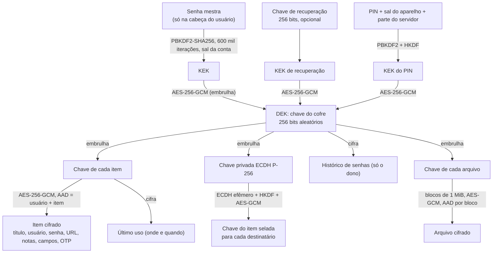
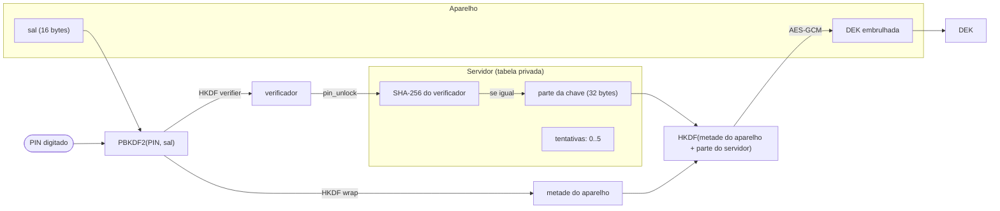

# Criptografia e chaves

Toda a criptografia roda no cliente com **WebCrypto**, sem primitivas próprias. Código: `web-saas/src/lib/crypto/`. Padrões: [Padrões e frameworks](/reference/standards).

## 1. Hierarquia de chaves (hoje)

## 2. Primitivas

| Primitiva | Parâmetros | Uso | Padrão |
|---|---|---|---|
| AES-256-GCM | IV aleatório de 96 bits; AAD com contexto | Itens, embrulho de chaves, arquivos, exportação, PIN, uso | SP 800-38D |
| PBKDF2-HMAC-SHA256 | 600 mil iterações (aceita de 600 mil a 5 milhões; recusa menos) | Senha mestra, exportação, link com senha, PIN | SP 800-132, OWASP |
| HKDF-SHA256 | Rótulos de contexto versionados (`securevault:...:v1`) | Selagem ECDH, PIN | RFC 5869 |
| ECDH P-256 | Efêmero-estático (estilo ECIES) | Compartilhamento | SP 800-56A |
| SHA-256 | — | Cadeia de auditoria, verificador do PIN, hash de sites | FIPS 180-4 |
| HMAC-SHA1/256/512 | 6 a 8 dígitos, período de 10 a 300 s | OTP de sistemas externos | RFC 6238 |

## 3. Propriedades garantidas
1. **Nem o fornecedor lê:** o servidor só recebe texto cifrado, chaves embrulhadas e chaves seladas.
2. **Integridade:** o AES-GCM com AAD faz falhar qualquer troca de texto cifrado entre itens, usuários ou versões.
3. **Isolamento por item:** comprometer a chave de um item não abre os outros. Revogar um compartilhamento gira a chave do item.
4. **Sem rebaixamento:** o cliente recusa parâmetros de KDF fracos vindos do servidor.
5. **Memória:** a DEK é importada como não exportável no app web e apagada ao bloquear. A extensão guarda a DEK em `chrome.storage.session` (só RAM) para sobreviver ao reinício do service worker.

## 4. Desenho do PIN

- **Aparelho roubado:** sem a parte do servidor; o servidor libera no máximo 5 tentativas e então apaga o registro.
- **Servidor vazado:** sem o sal e sem a DEK embrulhada, não há como testar PINs.
- **Os dois comprometidos:** força bruta de 10⁶ PINs com PBKDF2 a 600 mil iterações. Risco aceito, igual ao dos concorrentes. O registro vale 14 dias.

## 5. Alvo (versão 2)
- **Argon2id** no lugar do PBKDF2, com migração no desbloqueio.
- **Secret Key** obrigatória, combinada à senha mestra por HKDF, com Kit de Emergência.
- **Biometria** presa ao Secure Enclave, StrongBox ou TPM.
- **Passkey com PRF** para desbloquear.
- **Rotação da DEK.**
- **Compartilhamento híbrido** P-256 + ML-KEM-768 até 2030.

Detalhes em [Garantia de segurança](/security/security-assurance), seção 8.
