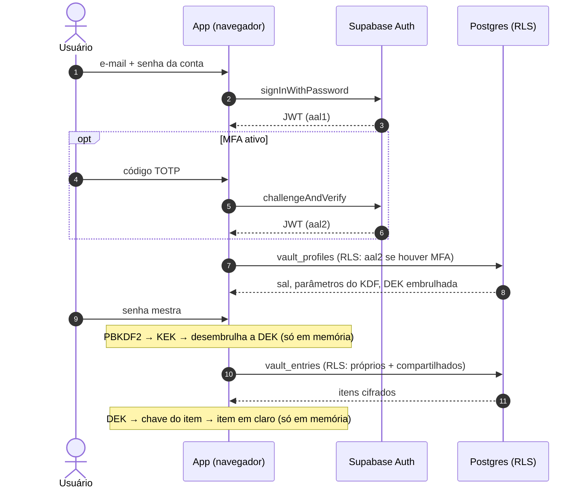
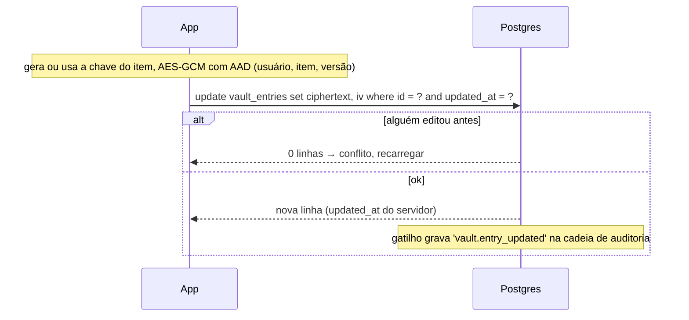
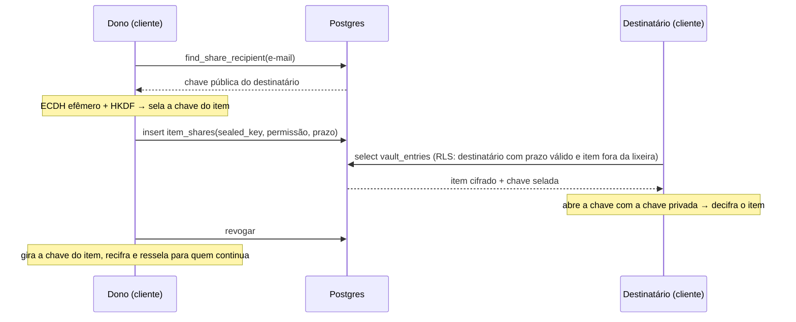
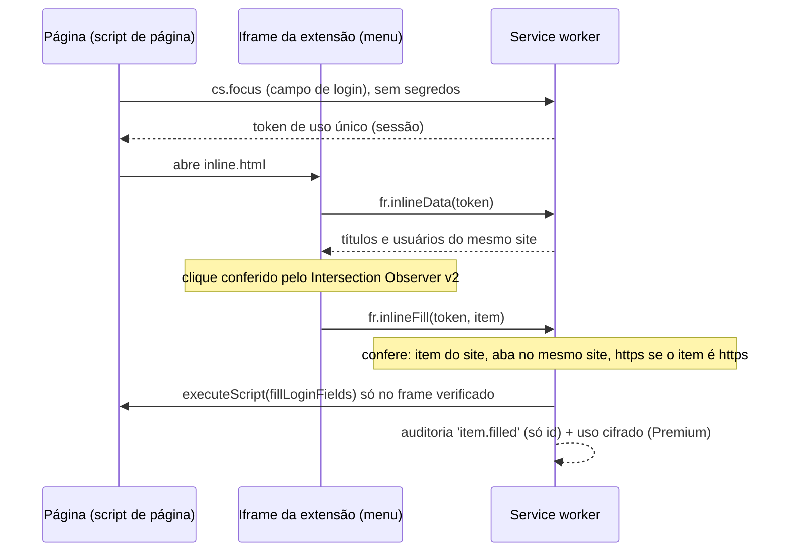
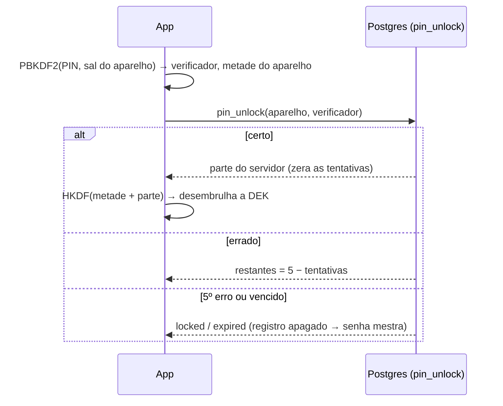
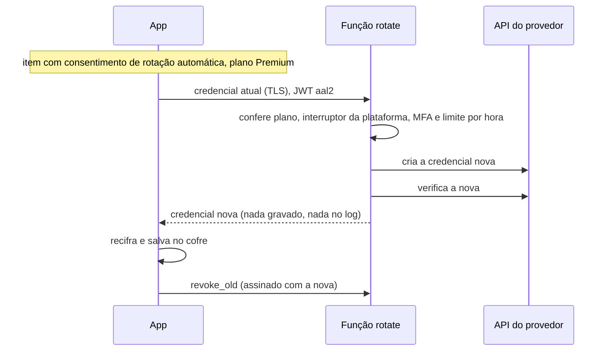
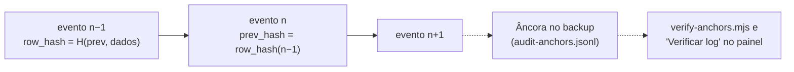

# Fluxos (diagramas de sequência)

Úteis para o desenvolvimento e para o pentest: cada passo mostra **o que atravessa a rede** e quem decide.

## Entrar e desbloquear

## Salvar um item

## Compartilhar e revogar

## Preencher pela extensão

## Desbloquear com PIN

## Rotação em 1 clique (exceção ao zero-knowledge)

## Auditoria encadeada

