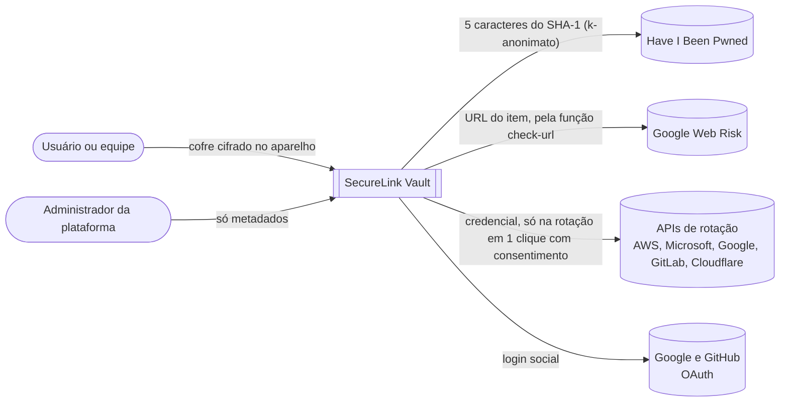
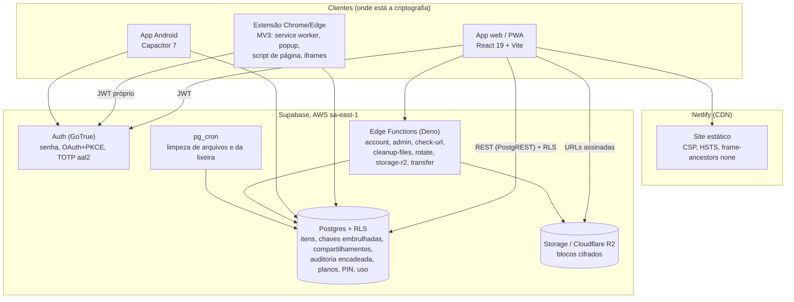
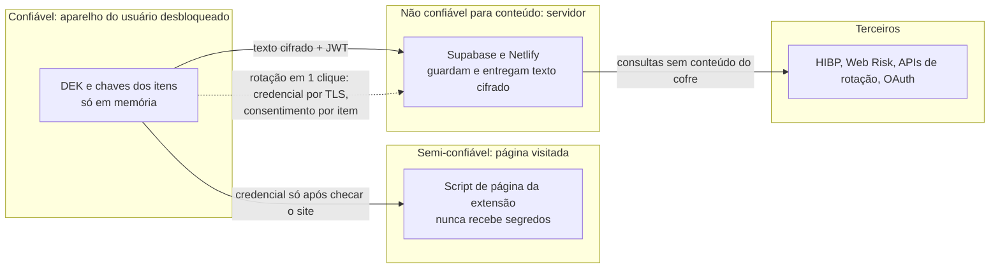
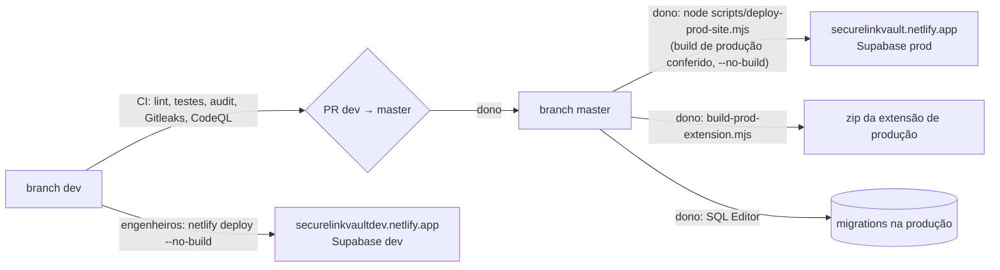
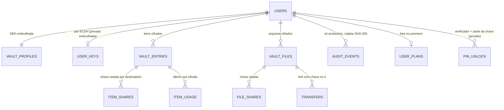

# Arquitetura: visão geral

Diagramas no estilo C4 (contexto, contêineres, fronteiras de confiança). A criptografia está em [Criptografia e chaves](./cryptography) e os passo a passo em [Fluxos](./flows). A comparação com o mercado está na [revisão comparada](./security-architecture-review).

## 1. Contexto

## 2. Contêineres

## 3. Fronteiras de confiança

| Fronteira | Ameaça | Controle |
|---|---|---|
| Aparelho e servidor | Servidor ou banco comprometido | Zero-knowledge: só texto cifrado, chave por item, RLS e auditoria encadeada |
| Aparelho e página | Página maliciosa ou clickjacking | Script de página sem segredos, iframes da extensão, Intersection Observer v2, remetente conferido, preenchimento só no mesmo site |
| Servidor e terceiros | Vazamento por consulta | k-anonimato no HIBP; só a URL vai ao Web Risk; a rotação é a exceção documentada |
| Operador e produção | Computador do dono comprometido | Bloqueio B2: chaves físicas, cofre para os segredos, publicação só pela CI |
| Entrega do código web | Deploy malicioso | Script de publicação verificado; B8: CI com tag assinada e hash do bundle |

## 4. Ambientes e publicação

## 5. Modelo de dados (simplificado)

