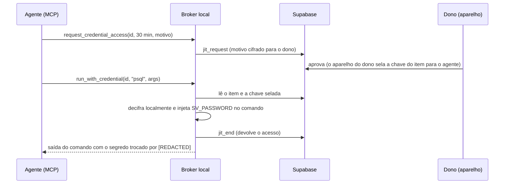

# Credenciais para agentes de IA (broker MCP)

Ideia 9.6 de [innovation](innovation.md), implementada em 2026-11-12 em `agent-broker/`. Depende do acesso temporário com aprovação (9.1).

## O que resolve

Agentes de IA (Claude Code, Cursor, agentes de automação) precisam de credenciais para rodar migrações, chamar APIs ou fazer deploy. Hoje é comum colar a senha no chat ou deixá-la num `.env`. As duas coisas dão ao agente **acesso permanente** e colocam o segredo no **contexto do modelo**: ele vai parar em logs, histórico e telemetria.

O broker dá ao agente **acesso temporário, aprovado por uma pessoa, a uma credencial por vez**. Por padrão o segredo **nunca entra no contexto do modelo**.

## Como funciona



- **O agente é uma conta comum do SecureVault** (uma "conta robô" dedicada). Ela não guarda segredos próprios; só pode **pedir** acesso aos itens para os quais o dono a tornou elegível.
- **Cada uso é um pedido JIT** com justificativa (marcada como `[agente de IA]`). Precisa da aprovação do dono ou, com controle duplo, de k de N aprovadores. O servidor define o prazo.
- **Zero-knowledge preservado.** A chave do item é selada pelo aparelho de quem aprova para a chave pública do agente. O broker decifra **na máquina do operador**. O servidor nunca vê nada em claro.
- **`run_with_credential`** roda **um** comando, sem shell, com o usuário e a senha em variáveis de ambiente (`SV_USERNAME`, `SV_PASSWORD`, `SV_URL` e `SV_OTP` quando houver). Troca o segredo por `[REDACTED]` na saída e, por padrão, **encerra o acesso** em seguida.
- **`reveal_credential`** (devolver o segredo ao modelo) vem **desligado**. Só funciona com `SV_ALLOW_REVEAL=1`.
- **Com "exigir troca após o uso"** marcado na elegibilidade, o dono recebe o aviso de troca de senha depois de cada uso do agente.

## Ferramentas MCP

| Ferramenta | Faz | Segredo vai ao modelo? |
|---|---|---|
| `list_credentials` | Lista o que o agente pode pedir (título, usuário, site, dono, limites, estado) | Não |
| `request_credential_access` | Abre um pedido JIT com prazo e motivo | Não |
| `check_access` | Estado do último pedido | Não |
| `run_with_credential` | Roda um comando com a credencial injetada; saída redigida; encerra o acesso | Não |
| `end_access` | Devolve o acesso antes do prazo | Não |
| `reveal_credential` | Devolve o segredo (só com `SV_ALLOW_REVEAL=1`) | **Sim** |

## Instalação (operador)

1. Crie a conta robô, por exemplo `agente-ci@suaempresa`. Entre uma vez no app, crie a senha mestra e abra o cofre (isso gera as chaves de compartilhamento).
2. Como dono (Premium), em **Acesso temporário**, permita que a conta robô peça acesso ao item. Recomendado: marcar "exigir troca após o uso" e, para produção, exigir 2 aprovações.
3. Gere o broker: `node agent-broker/build.mjs`. O resultado é `agent-broker/dist/securevault-mcp.mjs`, um arquivo só, que usa as bibliotecas já instaladas em `web-saas`.
4. Configure o cliente MCP. Exemplo para Claude Code (`.mcp.json`):

```json
{
  "mcpServers": {
    "securevault": {
      "command": "node",
      "args": ["/caminho/agent-broker/dist/securevault-mcp.mjs"],
      "env": {
        "SV_SUPABASE_URL": "https://<projeto>.supabase.co",
        "SV_SUPABASE_ANON_KEY": "<anon key pública>",
        "SV_AGENT_EMAIL": "agente-ci@suaempresa",
        "SV_AGENT_PASSWORD": "${SV_AGENT_PASSWORD}",
        "SV_AGENT_MASTER_PASSWORD": "${SV_AGENT_MASTER_PASSWORD}",
        "SV_ALLOWED_COMMANDS": "psql,gh,aws"
      }
    }
  }
}
```

Guarde `SV_AGENT_PASSWORD` e `SV_AGENT_MASTER_PASSWORD` no cofre de segredos do sistema operacional e injete-os no ambiente; não os grave no arquivo. Se a conta robô usar MFA, informe também `SV_AGENT_TOTP` (base32).

## Controles e limites conhecidos

| Controle | Como |
|---|---|
| Sem acesso permanente | Só pedidos JIT, de 15 min a 8 h, com prazo do servidor |
| Aprovação humana | Dono ou k de N aprovadores, sempre no aparelho deles |
| Mínimo privilégio de execução | `SV_ALLOWED_COMMANDS`; sem shell; nomes de variáveis reservados (`PATH`, `NODE_OPTIONS`...) recusados; segredos do próprio broker removidos do ambiente do comando |
| Exposição ao modelo | Saída redigida; `reveal` desligado por padrão |
| Rastreabilidade | Pedido, aprovação e encerramento na trilha de auditoria (cadeia de hash) dos dois lados |

**Limites:**
- O comando recebe a senha em claro. Um comando malicioso ou com log verboso pode vazá-la; a redação cobre só a saída capturada. Use a lista de comandos permitidos.
- A redação é por texto exato: uma senha transformada (base64, URL-encoded) não é redigida.
- O broker roda com as credenciais da conta robô. Proteja a máquina e o cofre do sistema operacional como protegeria um runner de CI.

## Testes

- Offline (CI): `node agent-broker/build.mjs && node --test agent-broker/test/broker.test.mjs` cobre o protocolo MCP, a redação, as variáveis de ambiente, a lista de comandos e o `reveal` desligado.
- Com o dev (manual, roteiro de validação §2.9): conta robô elegível, pedido, aprovação no app, `run_with_credential` com `node -e "console.log(process.env.SV_PASSWORD)"`. A saída esperada é `[REDACTED]` e o acesso aparece como encerrado.
