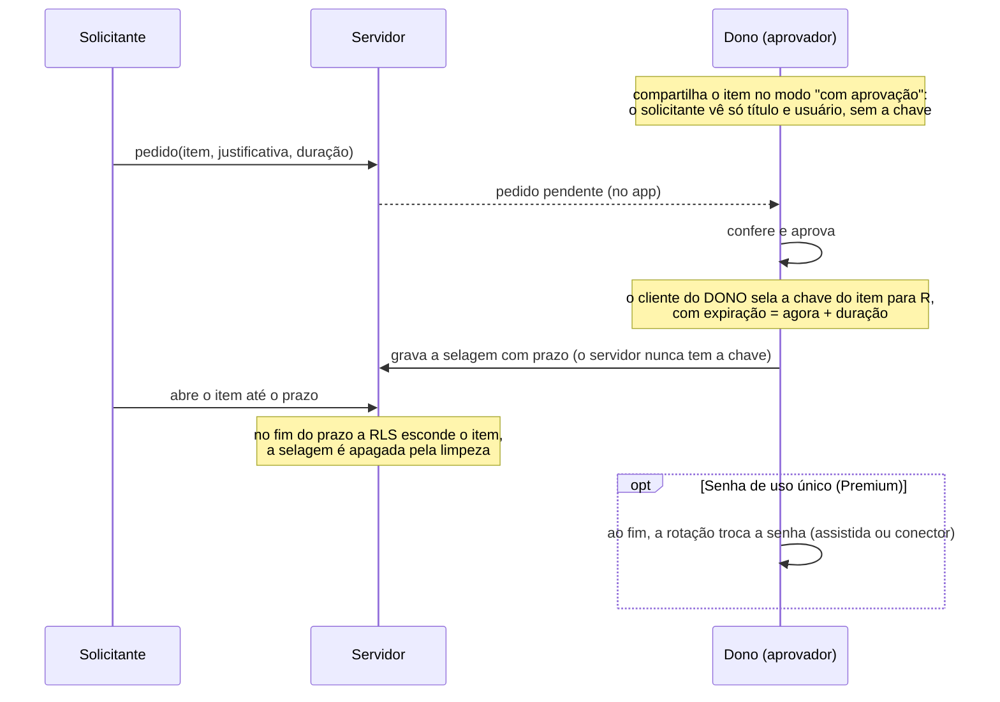

# Inovação: implementação

As ideias da [revisão comparada](/architecture/security-architecture-review) (seção 9), em ordem de entrega. Cada uma tem desenho, responsável e critério de aceite. O engenheiro de segurança revisa o desenho **antes** do código e faz o reteste **depois**.

| # | Ideia | Plano | Responsável | Estado |
|---|---|---|---|---|
| 9.5 | Secured Items brasileiros com alerta de vencimento | Free e Premium (o alerta de vencimento no Premium) | Solução A | Fase 1 em implementação |
| 9.4 | Relatório de evidências de troca | Premium | Solução A | Fase 1 em implementação |
| 9.3 | Auditoria verificável publicamente (OpenTimestamps) | Plataforma | Solução A + Segurança | Fase 1 em implementação |
| 9.1 | Acesso just-in-time com aprovação, sem o servidor ver o segredo | Premium | Solução A (servidor) + B (telas) + Segurança | Fase 1 em implementação |
| 9.2 | Rotação no cliente (sem passar pelo servidor) | Premium | Solução B | Planejado (depende do app de desktop em Tauri ou do service worker da extensão) |
| 9.6 | Credenciais para agentes de IA (conector MCP com aprovação) | Business | Solução B + Segurança | Planejado (depende de 9.1) |
| 9.7 | Analytics de risco sem ver conteúdo (empresas e MSPs) | Business | Solução A | Planejado (depende de organizações) |
| 9.8 | Contingência como recurso | Todos | — | ✅ Feito (falta o contato de emergência, fase 2) |

---

## 9.5 Secured Items brasileiros
- **O quê:** novos tipos de segredo:
  - **certificado digital A1** (e-CPF/e-CNPJ, `.pfx` como anexo cifrado, senha e validade);
  - **chave Pix** (tipo e valor);
  - **conta gov.br**;
  - **credencial fiscal** (NF-e, prefeitura);
  - **procuração**.

  Todos ganham um campo **validade**.
- **Alerta:** a validade entra na fila de prazos ("vence em 12 dias") e na postura, como os riscos de senha.
- **Aceite:** um certificado com validade em 20 dias aparece na fila de Rotação e na Visão geral; a validade fica cifrada no item.

## 9.4 Relatório de evidências de troca
- **O quê:** um arquivo CSV gerado **no aparelho**, com uma linha por item. Colunas:
  - última troca de senha;
  - riscos atuais;
  - prazo e situação (no prazo ou vencido);
  - troca programada;
  - última rotação automática registrada na auditoria (data e resultado).

  Sem senhas e sem URLs: o arquivo mostra só o título, que o usuário pode trocar por um código.
- **Para quê:** evidência para auditorias (LGPD, ISO 27001 A.5.17, SOC 2 CC6) e para o cliente corporativo.
- **Aceite:** o arquivo abre no Excel; nenhuma coluna traz segredos; o cabeçalho registra a data e a conta.

## 9.3 Auditoria verificável publicamente
- **O quê:** a cada backup, o hash da âncora da cadeia é carimbado no **OpenTimestamps**, um serviço gratuito que ancora no Bitcoin. O comprovante `.ots` fica ao lado do backup.
- **Por que é forte:** prova, para qualquer auditor e sem confiar no SecureLink, que a cadeia já existia naquela data. Reescrever o histórico depois disso fica detectável.
- **Privacidade:** só sai um hash de 32 bytes, que não revela eventos.
- **Aceite:** `backup.mjs` grava `audit-anchors.ots`; o `ots verify` confirma depois que o bloco for minerado (algumas horas).

## 9.1 Acesso just-in-time com aprovação (zero-knowledge)

- **Fase 1:**
  - um aprovador (o dono);
  - prazos de 15 min a 8 h;
  - justificativa obrigatória;
  - tudo na auditoria (pedido, aprovação, recusa, expiração);
  - no fim do prazo, a fila de Rotação sugere trocar a senha.
- **Fase 2:**
  - **2 de N aprovadores** com segredo dividido (Shamir): nenhum aprovador sozinho libera;
  - **exclusividade**: um solicitante por vez;
  - troca automática após o uso pelos conectores.
- **Por que inova:** na CyberArk, o controle duplo é regra de um cofre que conhece o segredo. Aqui o servidor **não consegue** liberar o segredo, nem se for comprometido.
- **Ameaças para o engenheiro de segurança revisar:**
  - o solicitante tenta ler a chave antes da aprovação;
  - o servidor tenta estender o prazo;
  - repetição de pedido;
  - o dono aprova por engano (a tela mostra quem pediu, o porquê e por quanto tempo);
  - cópia feita pelo solicitante durante o prazo, que é inerente e por isso combinada com a senha de uso único.
- **Aceite:**
  - antes da aprovação, a RLS não entrega a chave selada;
  - depois do prazo, o item some;
  - testes de integração com duas contas.

## 9.2 Rotação no cliente
Executar os conectores no **service worker da extensão** ou no **app de desktop (Tauri)**, chamando a API do provedor direto do aparelho. A função `rotate` passa a ser só um fallback. A barreira técnica é o CORS: AWS, Graph e GitLab aceitam chamadas sem CORS só fora do navegador, por isso o caminho natural é o desktop.

## 9.6 Agentes de IA
Um servidor MCP local em que o agente **pede** uma credencial com escopo e prazo, e a pessoa aprova pelo fluxo 9.1. O agente recebe a credencial selada para a chave dele, com expiração. Depende de 9.1 e do app de desktop.

## 9.7 Analytics sem ver conteúdo
Agregar, por organização, as contagens que a postura já calcula no aparelho (fracas, vazadas, vencidas, prazo médio de troca) e mostrar ao administrador, sem nenhum título ou URL. Depende de organizações (plano Business).
